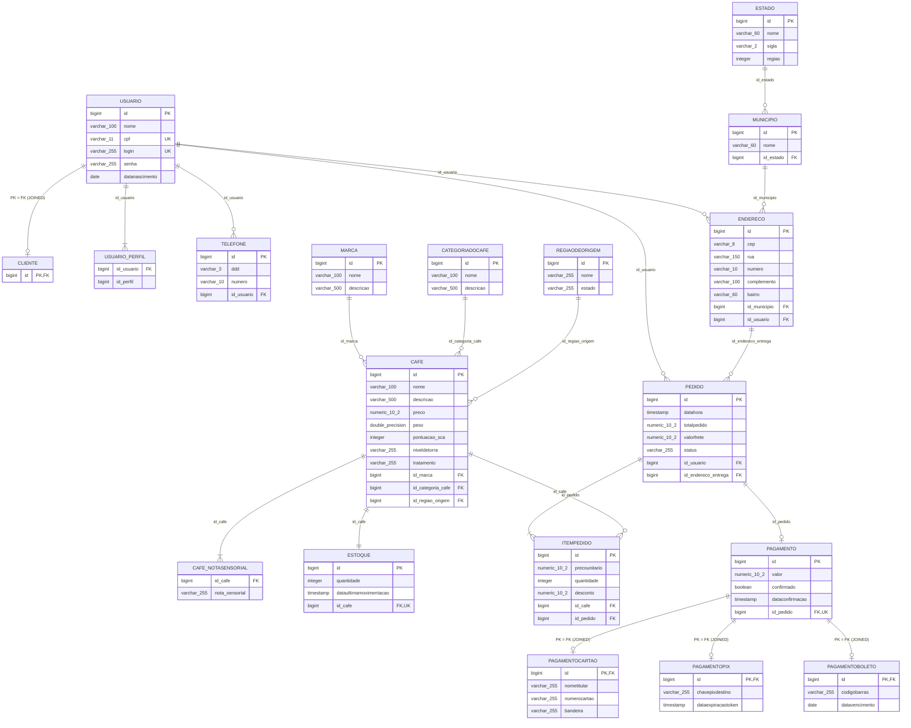

# 02 - Entendimento do Domínio e Modelagem UML Atual

**Data da Auditoria:** 20/10/2026  
**Auditor:** Arquiteto de Domínio / Auditor de Persistência  
**Fase:** 1 (Estado Atual do Domínio e Relacionamentos)  
**Regra:** Documentação fiel ao código e ao schema PostgreSQL existentes hoje.  

---

## 1. Diagrama de Classes UML (Estado Atual do Código Java)

Este diagrama representa com fidelidade absoluta as entidades, tipos primitivos/objetos, enums e anotações JPA como estão implementadas no pacote `src/main/java`.

```mermaid
classDiagram
    direction TB

    class DefaultEntity {
        <<abstract>>
        -Long id
        +getId() Long
        +setId(Long id) void
    }

    class Usuario {
        -String nome
        -String cpf
        -String login
        -String senha
        -LocalDate dataNascimento
        -List~Telefone~ telefones
        -List~Endereco~ enderecos
        -Set~Perfil~ perfis
    }

    class Cliente {
        <<JOINED>>
    }

    class Perfil {
        <<enumeration>>
        ADM : (1L, "Administrador")
        USER : (2L, "Usuario")
    }

    class Telefone {
        -String ddd
        -String numero
        -Usuario usuario
    }

    class Endereco {
        -String cep
        -String rua
        -String numero
        -String complemento
        -String bairro
        -Municipio municipio
        -Usuario usuario
    }

    class Estado {
        -String nome
        -String sigla
        -Regiao regiao
    }

    class Municipio {
        -String nome
        -Estado estado
    }

    class Regiao {
        <<enumeration>>
        CENTRO_OESTE : (1L, "Centro-Oeste")
        NORDESTE : (2L, "Nordeste")
        NORTE : (3L, "Norte")
        SUDESTE : (4L, "Sudeste")
        SUL : (5L, "Sul")
    }

    class RegiaoDeOrigem {
        <<Entity - Órfã>>
        -String nome
        -String estado
    }

    class Cafe {
        -String nome
        -String descricao
        -BigDecimal preco
        -Double peso
        -Integer pontuacaoSCA
        -NivelDeTorra nivelDeTorra
        -Tratamento tratamento
        -Marca marca
        -CategoriaDoCafe categoriaDoCafe
        -RegiaoDeOrigem regiaoDeOrigem
        -Set~NotaSensorial~ notasSensoriais
    }

    class Marca {
        -String nome
        -String descricao
    }

    class CategoriaDoCafe {
        -String nome
        -String descricao
    }

    class NivelDeTorra {
        <<enumeration>>
        CLARA : (1L, "Clara")
        MEDIA_CLARA : (2L, "Média Clara")
        MEDIA : (3L, "Média")
        MEDIA_ESCURA : (4L, "Média Escura")
        ESCURA : (5L, "Escura")
    }

    class Tratamento {
        <<enumeration>>
        NATURAL : (1L, "Natural")
        LAVADO : (2L, "Lavado")
        HONEY : (3L, "Honey")
        SEMI_LAVADO : (4L, "Semi-lavado")
        DESCASCADO_NATURAL : (5L, "Descascado Natural")
        ANAEROBICO : (6L, "Anaeróbico")
        FERMENTACAO_CONTROLADA : (7L, "Fermentação Controlada")
        EXPERIMENTAL : (8L, "Experimental")
    }

    class NotaSensorial {
        <<enumeration>>
        FRUTAS_VERMELHAS, CITRICO, CHOCOLATE, CARAMELO, FLORAL, NOZES, ESPECIARIAS, FRUTAS_AMARELAS, RAPADURA, BAUNILHA, HERBAL, AMENDOAS, CHOCOLATE_AO_LEITE, PESSEGO, FRUTAS_TROPICAIS, MEL
    }

    class Estoque {
        -Integer quantidade
        -LocalDateTime dataUltimaMovimentacao
        -Cafe cafe
    }

    class Pedido {
        -LocalDateTime dataHora
        -BigDecimal totalPedido
        -BigDecimal valorFrete
        -PedidoStatus status
        -Usuario usuario
        -Endereco enderecoEntrega
        -List~ItemPedido~ itens
        -Pagamento pagamento
    }

    class PedidoStatus {
        <<enumeration>>
        AGUARDANDO_PAGAMENTO : (1L, "Aguardando Pagamento")
        PAGO : (2L, "Pago")
        SEPARACAO : (3L, "Em Separação")
        ENVIADO : (4L, "Enviado")
        ENTREGUE : (5L, "Entregue")
        CANCELADO : (6L, "Cancelado")
    }

    class ItemPedido {
        -BigDecimal precoUnitario
        -Integer quantidade
        -BigDecimal desconto
        -Cafe cafe
        -Pedido pedido
        +getSubTotal() BigDecimal
    }

    class Pagamento {
        <<abstract, JOINED>>
        -BigDecimal valor
        -Boolean confirmado
        -LocalDateTime dataConfirmacao
        -Pedido pedido
    }

    class PagamentoCartao {
        -String nomeTitular
        -String numeroCartao
        -String bandeira
    }

    class PagamentoPix {
        -String chavePixDestino
        -LocalDateTime dataExpiracaoToken
    }

    class PagamentoBoleto {
        -String codigoBarras
        -LocalDate dataVencimento
    }

    DefaultEntity <|-- Usuario
    DefaultEntity <|-- Endereco
    DefaultEntity <|-- Telefone
    DefaultEntity <|-- Estado
    DefaultEntity <|-- Municipio
    DefaultEntity <|-- RegiaoDeOrigem
    DefaultEntity <|-- Cafe
    DefaultEntity <|-- Marca
    DefaultEntity <|-- CategoriaDoCafe
    DefaultEntity <|-- Estoque
    DefaultEntity <|-- Pedido
    DefaultEntity <|-- ItemPedido
    DefaultEntity <|-- Pagamento

    Usuario <|-- Cliente : InheritanceType.JOINED
    Pagamento <|-- PagamentoCartao : InheritanceType.JOINED
    Pagamento <|-- PagamentoPix : InheritanceType.JOINED
    Pagamento <|-- PagamentoBoleto : InheritanceType.JOINED

    Usuario "1" *-- "0..*" Telefone : cascade ALL, orphanRemoval
    Usuario "1" *-- "0..*" Endereco : cascade ALL, orphanRemoval
    Usuario "1" o-- "1..*" Perfil : ElementCollection (usuario_perfil)

    Municipio "0..*" --> "1" Estado : id_estado
    Endereco "0..*" --> "1" Municipio : id_municipio
    Endereco "0..*" --> "1" Usuario : id_usuario

    Cafe "0..*" --> "1" Marca : id_marca
    Cafe "0..*" --> "1" CategoriaDoCafe : id_categoria_cafe
    Cafe "0..*" --> "0..1" RegiaoDeOrigem : id_regiao_origem (Órfão)
    Cafe "1" o-- "0..*" NotaSensorial : ElementCollection (cafe_notasensorial)
    Estoque "1" --> "1" Cafe : id_cafe (unique)

    Pedido "0..*" --> "1" Usuario : id_usuario
    Pedido "0..*" --> "1" Endereco : id_endereco_entrega
    Pedido "1" *-- "1..*" ItemPedido : cascade ALL, orphanRemoval
    ItemPedido "0..*" --> "1" Cafe : id_cafe
    ItemPedido "0..*" --> "1" Pedido : id_pedido
    Pagamento "1" --> "1" Pedido : id_pedido (unique)
```

---

## 2. Diagrama Entidade-Relacionamento (Schema Real do PostgreSQL 17)

Este diagrama reflete as tabelas, tipos de dados, chaves primárias e estrangeiras efetivamente inspecionadas via `psql` no banco de dados `topicos1db`.

---

## 3. Confronto JPA (Código) × Schema PostgreSQL (Banco de Dados)

Durante a auditoria, foram identificadas divergências estruturais marcantes entre o que as classes Java declaram e o que o banco de dados tem:

| Elemento | Declaração no JPA / Código | Schema Real PostgreSQL | Impacto / Severidade |
|---|---|---|---|
| **`Cafe.peso`** | `private Double peso` | `double precision not null` | **Alto:** Viola a boa prática de precisão física em pesagem de grãos (gramas/kg com `BigDecimal` ou `Integer` em gramas). |
| **`Cafe.id_marca` / `id_categoria`** | Anotado como `@JoinColumn(nullable = false)` | `Pode ser nulo: YES` na tabela PostgreSQL | **Médio:** Inconsistência de DDL. O banco permite salvar um café sem marca ou categoria caso inserido via SQL direto. |
| **`NivelDeTorra` / `Tratamento`** | Existem conversores `@Converter(autoApply = true)` para converter enum em `Long ID` | Salvo como `varchar(255)` com CHECK constraint de Strings | **Médio:** Conflito de precedência. A anotação `@Enumerated(EnumType.STRING)` sobrepôs o conversor JPA, gerando strings no banco. |
| **`Pagamento.id_pedido`** | `@JoinColumn(name = "id_pedido", nullable = false, unique = true)` | `Pode ser nulo: YES` (apenas com restrição UNIQUE) | **Médio:** O PostgreSQL permite pagamentos sem pedido associado (`id_pedido IS NULL`). |
| **Tabelas Fantasmas no Banco** | Inexistentes no código Java | Tabelas `fornecedor`, `produto`, `produto_sabor`, `sabor`, `categoria` presentes no PostgreSQL | **Alto:** Resíduos de versões anteriores não dropados devido à propriedade deprecated `drop-and-create`. |
| **`RegiaoDeOrigem`** | `@Entity public class RegiaoDeOrigem` | Tabela `regiaodeorigem` criada no PostgreSQL | **Baixo:** Entidade órfã no código e no banco (sem uso prático nos DTOs ou APIs). |

---

## 4. Avaliação Crítica de Cada Relacionamento Existente

### 4.1 `Usuario` ↔ `Cliente` (Herança JOINED)
- **Como está:** `@Inheritance(strategy = InheritanceType.JOINED)`. A tabela `cliente` possui apenas `id bigint REFERENCES usuario(id)`. A classe `Cliente.java` não possui nenhum atributo.
- **Problema:** A relação não define claramente as responsabilidades. Um cliente só se diferencia de um administrador porque no `usuario_perfil` tem perfil `USER` (2L) em vez de `ADM` (1L). Não existe classe `Administrador`.
- **Risco:** O papel de administrador é uma anotação em tabela de relacionamento (`usuario_perfil`), o que permite que uma chamada em `UsuarioResource` promova um cliente comum a admin sem que haja uma entidade com restrições explícitas.

### 4.2 `Usuario` ↔ `Telefone` / `Endereco`
- **Cardinalidade:** 1:N (Um usuário possui vários telefones e vários endereços).
- **Lado dono:** `Telefone` e `Endereco` (`@ManyToOne @JoinColumn(name = "id_usuario")`).
- **Cascade e OrphanRemoval:** `@OneToMany(mappedBy = "usuario", cascade = CascadeType.ALL, orphanRemoval = true)`.
- **Avaliação de Risco:** 
  > [!CAUTION]
  > **Risco de Quebra de Integridade Referencial:** Se um usuário for deletado via `UsuarioRepository.delete(usuario)`, o `CascadeType.ALL` dispara a exclusão física de todos os seus endereços. No entanto, se esse usuário já tiver realizado pedidos, a tabela `pedido` possui uma chave estrangeira `id_endereco_entrega` apontando para o endereço. O PostgreSQL lançará imediatamente uma violação de chave estrangeira (`PSQLException: 23503 foreign_key_violation`), resultando em **HTTP 500**.
  > Além disso, um e-commerce **nunca** deve apagar o histórico de endereços de entrega de pedidos já faturados.

### 4.3 `Pedido` ↔ `Usuario`
- **Como está:** `@ManyToOne @JoinColumn(name = "id_usuario", nullable = false) private Usuario usuario;`
- **Problema de Domínio:** O pedido está vinculado a `Usuario` e não a `Cliente`. Um administrador do sistema teoricamente pode "comprar", mas em regras de negócio de e-commerce, quem compra é o cliente (com histórico de compras, programa de fidelidade, etc.).
- **Bidirecionalidade:** Unidirecional a partir de `Pedido`. Em `Usuario` não há lista `pedidos`. Isso é positivo para evitar carregamentos massivos indesejados.

### 4.4 `Pedido` ↔ `ItemPedido` ↔ `Cafe`
- **Cardinalidade:** `Pedido` 1:N `ItemPedido` (dono é `ItemPedido`). `ItemPedido` N:1 `Cafe`.
- **Cascade:** `Pedido` possui `cascade = CascadeType.ALL, orphanRemoval = true` para seus itens. Adequado: o ciclo de vida dos itens depende estritamente do pedido.
- **Snapshot de Preço:** O campo `precoUnitario` em `ItemPedido` é persistido a partir de `cafe.getPreco()` no momento do pedido (`PedidoServiceImpl:149`). **Ponto positivo confirmado:** o histórico de preços é preservado se o catálogo de café sofrer reajuste posterior.
- **Cálculo de Totais:** O cálculo `totalPedido = totalItens + valorFrete` é executado no Service com `BigDecimal`. Adequado.
- **Risco de Deleção de Café:** Como comprovado na Fase 0, tentar deletar um café que já conste em `itempedido` dispara `PSQLException` com violação de FK. O e-commerce precisa de soft delete (`ativo = false`) para produtos do catálogo.

### 4.5 `Pedido` ↔ `Pagamento`
- **Cardinalidade:** 1:1 unidirecional (`Pagamento` possui `@JoinColumn(name = "id_pedido", unique = true)`).
- **Herança de Pagamento:** `InheritanceType.JOINED` com `PagamentoCartao`, `PagamentoPix`, `PagamentoBoleto`.
- **Problema de Modelagem:** 
  1. No `Pedido`, o campo `pagamento` possui `@OneToOne(mappedBy = "pedido")`, mas não tem `cascade`. O pagamento é salvo em transação e endpoint separados (`/pagamentos/cartao`, etc.).
  2. Não há suporte a múltiplos pagamentos, estorno parcial, nem re-tentativa caso um boleto expire.
  3. Divergência nos dados de exemplo do `import.sql`: Pedido 1 possui total `1400.00`, mas o pagamento inicial foi gravado com `91.80`.

### 4.6 `Cafe` ↔ `Estoque`
- **Cardinalidade:** 1:1 (`Estoque` possui `@JoinColumn(name = "id_cafe", unique = true)`).
- **Problema Crítico de Concorrência:** A entidade `Estoque` **não possui controle de versão (`@Version`)**.
- **Impacto:** Em compras simultâneas no e-commerce, duas transações concorrentes leem a mesma quantidade e decrementam com base em dados obsoletos (Lost Update / Sobrescrita cega).
- **Desacoplamento Incompleto:** Embora exista a tabela `estoque`, o `CafeDTO` e `CafeDTOResponse` expõem o campo `estoque` diretamente no produto. A criação de café chama `estoqueService.iniciarEstoque`, gerando acoplamento direto no Service e N+1 queries nas listagens.

---

## 5. Confronto com o Domínio Real de E-commerce de Café Especial

Ao confrontar o modelo atual com os requisitos do mundo real de um e-commerce especializado em café gourmet/especial, identificamos lacunas importantes:

### 5.1 O que Existe Hoje
- Catálogo de cafés com Marca, Categoria, Pontuação SCA, Nível de Torra, Tratamento e Notas Sensoriais.
- Snapshot do preço unitário no Item do Pedido.
- Cálculo de frete rudimentar por UF/Região geográfica.
- Três formas de pagamento modeladas via herança JOINED.
- Controle básico de endereço e telefone do usuário.

### 5.2 O que Falta ou Está Mal Modelado (Sugestões para o Domínio Alvo)

1. **Ausência da Entidade `Carrinho` / `ItemCarrinho`:**
   - Hoje o cliente passa diretamente do catálogo para o `Pedido`. Não existe estado transitório de carrinho persistido na API. O cliente precisa enviar todos os itens de uma vez no payload de `POST /pedidos`.
2. **Moagem do Café (Atributo Crítico de Grãos de Café):**
   - Grãos de café especial são vendidos **em grãos inteiros** ou **moídos** (para Prensa Francesa, Filtro V60, Espresso, Cafeteira Italiana). Não há atributo de tipo de moagem nem em `Cafe` nem em `ItemPedido`.
3. **Snapshot de Dados do Café no Pedido:**
   - O `ItemPedido` guarda apenas o `id_cafe` e o `precoUnitario`. Se o nome do café for alterado ou o café for inativado, a visualização do histórico de pedidos pode ficar comprometida.
4. **Endereço de Entrega Imutável (Snapshot de Endereço):**
   - O `Pedido` aponta diretamente para a entidade `Endereco` do usuário via chave estrangeira. Se o cliente mudar de endereço ou editar a rua via `PUT /endereco/{id}`, **o endereço de pedidos passados já entregues será retroativamente alterado no banco**, ferindo conformidade fiscal e auditoria de entregas.
5. **E-mail Único de Usuário:**
   - A entidade `Usuario` possui `login` e `cpf`, mas **não possui o campo `email`**. Em e-commerce, o e-mail é o identificador universal para recuperação de senha, envio de comprovante de pagamento e rastreio.
6. **Hierarquia Limpa de Perfis (`Usuario` → `Cliente` / `Administrador`):**
   - O papel de Administrador não pode depender de um registro solto em tabela associativa `usuario_perfil`. Deve haver subclasses explícitas com papéis garantidos pelo framework de segurança.
