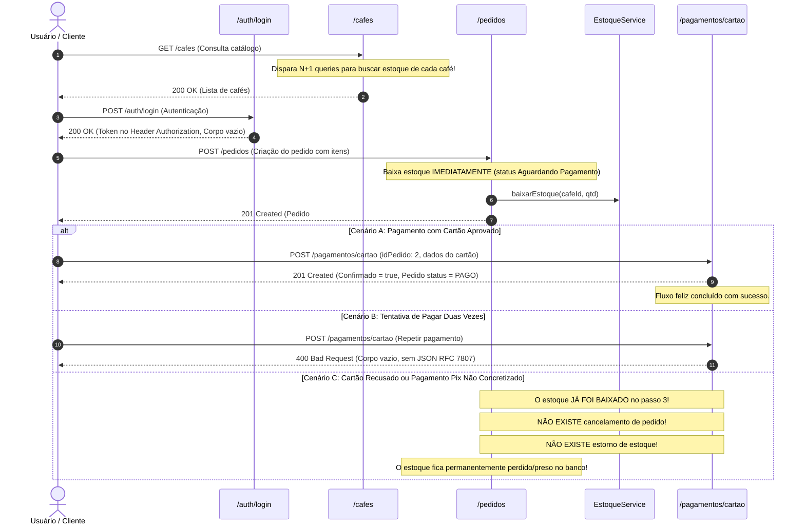

# 04 - Análise Cruzada entre Endpoints e Falhas de Lógica

**Data da Auditoria:** 20/10/2026  
**Auditor:** Auditor REST / Rastreador de Fluxos  
**Fase:** 2 (Consolidação da Análise Cruzada)  
**Objetivo:** Identificar inconsistências sistêmicas, concorrência desleal entre rotas, regras duplicadas com comportamentos divergentes e quebras em fluxos de ponta a ponta.

---

## 1. Conflito Estrutural: A Duplicidade Concorrente `/usuarios` vs `/clientes`

Este é o conflito mais crítico de toda a aplicação e a principal fonte de vazamento de segurança e desvio de regras de negócio.

| Aspecto | `ClienteResource` (`/clientes`) | `UsuarioResource` (`/usuarios`) | Diagnóstico do Conflito |
|---|---|---|---|
| **Segurança em `POST`** | `@PermitAll` (público) | Sem anotação (público) | Ambos abertos para cadastro. |
| **Atribuição de Perfil no Cadastro** | **Blindado:** Força estritamente `Perfil.USER` no Service (`ClienteServiceImpl:77`). | **Vulnerável:** Lê `dto.idPerfil()` e atribui qualquer perfil enviado no JSON (`UsuarioServiceImpl:59`). | **Brecha:** Um atacante cadastra um Admin por `/usuarios` sem credenciais. |
| **Validação `@Valid`** | Presente no `@POST` e `@PUT` do controller. | **Ausente:** `@POST` e `@PUT` não possuem `@Valid`. | **Inconsistência:** `/clientes` valida campos; `/usuarios` estoura `HTTP 500` com `NullPointerException`. |
| **Listagem Geral (`GET`)** | Protegido com `@RolesAllowed({"Administrador"})`. Retorna `401`/`403`. | **Sem proteção.** Retorna `HTTP 200 OK` para qualquer anônimo. | **Bypass de Segurança:** O atacante que toma `403` em `/clientes` simplesmente chama `/usuarios` e lista tudo. |
| **Consulta por ID (`GET /{id}`)** | Valida se o cliente autenticado é dono do ID (`validarPermissao`). | Não valida dono. Qualquer pessoa consulta qualquer ID. | Quebra total de privacidade e conformidade LGPD. |
| **Atualização (`PUT /{id}`)** | Valida posse via token; atualiza apenas dados cadastrais sem alterar perfis. | Sem autenticação; **permite alterar o perfil** de qualquer usuário existente para `ADM`. | **Escalada de Privilégio Imediata.** |

---

## 2. Inconsistência Crítica nos Padrões de Rota e Filtragem (Caos de Busca)

Não existe convenção uniforme para filtragem e buscas na API. Quatro padrões distintos competem entre si:

| Recurso | Endpoint Atual de Busca | Padrão Utilizado | Padrão REST Canônico Desejado |
|---|---|---|---|
| **Café** | `GET /cafes/search/nome/{nome}` | Verbo + Sub-rota + Path Param | `GET /cafes?nome=...` |
| **Café (Pontuação)** | `GET /cafes/search/pontuacao?min=&max=` | Verbo + Sub-rota + Query Params | `GET /cafes?minPontuacao=...&maxPontuacao=...` |
| **Categoria** | `GET /categorias/search/{nome}` | Verbo `search` + Path Param | `GET /categorias?nome=...` |
| **Marca** | `GET /marcas/search/{nome}` | Verbo `search` + Path Param | `GET /marcas?nome=...` |
| **Cliente** | `GET /clientes/search/{nome}` | Verbo `search` + Path Param | `GET /clientes?nome=...` |
| **Estado** | `GET /estados/find/{nome}` | Verbo `find` + Path Param | `GET /estados?nome=...` |
| **Município** | `GET /municipios/find/{nome}` | Verbo `find` + Path Param | `GET /municipios?nome=...` |
| **Usuário** | `GET /usuarios/find/{nome}` | Verbo `find` + Path Param | `GET /usuarios?nome=...` |
| **Endereço (CEP)** | `GET /endereco/find/cep/{cep}` | Singular + `find` + Path Param | `GET /enderecos?cep=...` |
| **Endereço (Rua)** | `GET /endereco/find/rua/{rua}` | Singular + `find` + Path Param | `GET /enderecos?rua=...` |

### Problemas dessa Discrepância
1. **Quebra de Cache e Proxy:** Parâmetros de busca em Path Params impedem filtros compostos (ex.: buscar café por nome E pontuação E marca simultaneamente).
2. **Inconsistência para o Frontend Angular:** O desenvolvedor frontend precisa adivinhar se usa `/find/` ou `/search/` ou `/search/nome/` para cada tela.
3. **Caracteres Especiais na URL:** Nomes com espaços, acentos ou barras enviados como Path Param quebram rotas HTTP caso não estejam 100% URL-encoded.

---

## 3. Duplicação de Regras de Negócio e Validação de Segurança

A validação de "usuário dono do recurso" foi implementada de duas formas concorrentes no código:

1. **`SecurityServiceImpl.java`:**
   - Possui métodos centralizados `validarPermissao(Usuario dono)` e `validarPermissao(Long idUsuarioAlvo)`.
   - Utilizado por: `EnderecoServiceImpl`, `TelefoneServiceImpl`, `PedidoServiceImpl`, `PagamentoServiceImpl`.
2. **`ClienteServiceImpl.java`:**
   - **Ignorou** o `SecurityService` e criou um método privado duplicado dentro da própria classe: `validarPermissao(Long idClienteIdDaUrl)`.
3. **`UsuarioServiceImpl.java`:**
   - **Não possui nenhuma validação de permissão.**
4. **`CafeServiceImpl.java`, `CategoriaDoCafeServiceImpl.java`:**
   - Segurança deixada inteiramente por conta de anotações no Resource, que foram desativadas com comentários `//`.

---

## 4. Análise dos Relacionamentos e Sub-Recursos Entre Endpoints

### 4.1 Descolamento de Sub-Recursos (Telefone e Endereço)
- Hoje, `Telefone` e `Endereco` são tratados como agregados de primeira classe com endpoints raiz próprios (`/telefones`, `/endereco`).
- **Problema:** Um cliente não tem um endpoint canônico para obter "meus endereços" ou "meus telefones".
- O controller `EnderecoResource` tem inclusive o endpoint comentado:
  ```java
  // SUGESTÃO: Endpoint essencial para o front-end "Meus Endereços"
  // @GET @Path("/usuario/{idUsuario}") ...
  ```
- **Hierarquia REST Esperada:**
  - `GET /clientes/me/enderecos` e `POST /clientes/me/enderecos`
  - `GET /clientes/me/telefones` e `POST /clientes/me/telefones`

### 4.2 Descolamento de Pagamento em Relação a Pedido
- Pagamentos são iniciados em rotas genéricas `/pagamentos/cartao`, `/pagamentos/pix`, `/pagamentos/boleto` passando `idPedido` no corpo JSON.
- **Problema:** O pagamento é uma transição de estado estritamente vinculada a um pedido existente. 
- Não existe endpoint para o cliente consultar o pagamento de seu pedido (ex.: obter o QR Code Pix ou código de barras após fechar a tela inicial).
- **Hierarquia REST Esperada:**
  - `POST /pedidos/{id}/pagamento`
  - `GET /pedidos/{id}/pagamento`

---

## 5. Rastreamento do Fluxo Completo de E-commerce (Ponta a Ponta)

Simulamos o fluxo completo de compra de ponta a ponta para identificar onde o sistema falha:



### Onde o Fluxo Quebra:
1. **Estoque Preso em Pedidos Não Pagos:** Como a baixa é imediata no `POST /pedidos`, se o usuário gerar um Pix e não pagar, os itens continuam subtraídos do estoque para sempre. Não há rotina de expiração de pedido nem cancelamento com estorno.
2. **Ausência de Transição de Estado:** O pedido não possui endpoints para transição de ciclo de vida (`CANCELADO`, `ENVIADO`, `ENTREGUE`).
3. **Exclusão de Café com Pedidos Pendentes:** Tentar deletar um café no catálogo que já foi comprado gera `500 Internal Server Error` no Hibernate por violação de integridade referencial.
