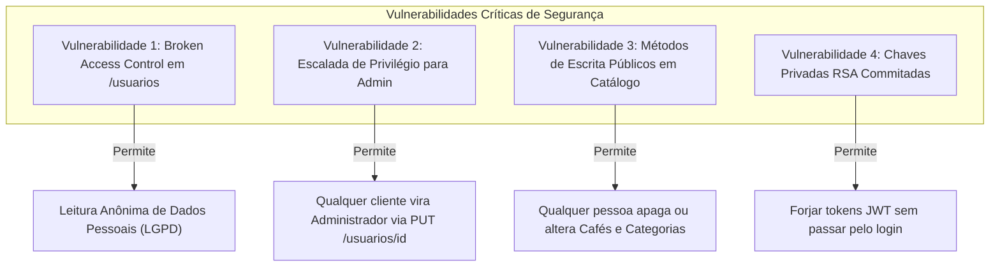

# 05 - Revisão das Demais Camadas e Aspectos Transversais

**Data da Auditoria:** 20/10/2026  
**Auditor:** Revisor de Qualidade e Segurança / Auditor de Persistência  
**Fase:** 3 (Camadas Internas, Segurança e Qualidade)  

---

## 1. Camada Service

### 1.1 Demarcação de Transações (`@Transactional`)
- **Sobreposição Incorreta de `@Transactional`:**
  - Em múltiplos Resources (ex.: `UsuarioResource`, `EstadoResource`, `MunicipioResource`, `CafeResource`), o método do controller está anotado com `@Transactional` ao mesmo tempo em que o método do `*ServiceImpl` correspondente também está anotado com `@Transactional`.
  - **Problema Arquitetural:** O controle transacional deve pertencer estritamente à camada de serviço/negócio. Resources finos não devem iniciar nem fechar transações diretamente.
- **Transação Ausente em Operações com Múltiplas Escritas:**
  - Em `AuthResource.login`, não há transação (correto, pois é leitura).
  - Em `CafeServiceImpl.create`, o método persiste `Cafe` e chama `estoqueService.iniciarEstoque`. Ambos estão com `@Transactional`, participando da mesma transação JTA via Narayana.

### 1.2 Uso Indevido de Exceções HTTP na Camada de Negócio
- A camada Service está acoplada diretamente ao pacote JAX-RS (`jakarta.ws.rs.*`):
  - `throw new NotFoundException(...)`
  - `throw new BadRequestException(...)`
  - `throw new ForbiddenException(...)`
- **Problema Arquitetural:** A camada de serviço não deve conhecer conceitos do protocolo HTTP (JAX-RS). Deve lançar exceções de domínio ou de negócio puras (ex.: `EntidadeNaoEncontradaException`, `RegraDeNegocioException`), e cabe aos `ExceptionMappers` na camada web traduzir tais exceções para status HTTP correspondentes (`404`, `422`, `400`).

---

## 2. Camada Repository e Persistência (Hibernate / JPA / SQL)

### 2.1 Análise de Consultas e Queries N+1
Conforme capturado no console do Hibernate durante a execução de `GET /cafes`, temos um caso flagrante e comprovado de **N+1 Queries**:
```sql
-- 1 query para buscar cafés
select c1_0.id, c1_0.nome, ... from Cafe c1_0;

-- N queries individuais disparadas para buscar o estoque de CADA café
select e1_0.id, e1_0.quantidade from Estoque e1_0 where e1_0.id_cafe = 1;
select e1_0.id, e1_0.quantidade from Estoque e1_0 where e1_0.id_cafe = 2;
```
- **Causa:** `CafeServiceImpl.findAll()` itera sobre o stream chamando `estoqueService.consultarQuantidade(cafe.getId())` de forma serial.
- **Solução Recomendada:** Uso de `JOIN FETCH` ou projeção DTO via query direta no banco (`SELECT new ... FROM Cafe c LEFT JOIN Estoque e ...`).

### 2.2 Injeção de SQL e Concatenação de Strings
- Analisamos todos os 12 repositórios do projeto.
- **Resultado:** Os repositórios que utilizam `PanacheRepository` implementam consultas usando parâmetros posicionais (`?1`) ou nomeados (`:minSCA`), como em `CafeRepository.findByPontuacaoRange` e `UsuarioRepository.findByLoginAndSenha`.
- **Risco de SQL Injection Direto:** Baixo / Não Confirmado. As queries Panache usam `PreparedStatement` por baixo dos panos.
- **Porém:** Há consultas desnecessárias de validação usando strings genéricas:
  `repository.find("cpf", dto.cpf()).firstResult()` (em `UsuarioServiceImpl:42`) em vez de métodos de repositório tipados.

---

## 3. Segurança e Auditoria de Vulnerabilidades

### 3.1 Classificação das Falhas de Segurança Identificadas



#### Falha 3.1.1: Broken Object Level Authorization & Exposição de Dados Pessoais (Confirmado)
- **Local:** `UsuarioResource.java`
- **Gravidade:** **Crítica (CVSS 9.1)**
- O endpoint `GET /usuarios` não possui nenhuma anotação de segurança e retorna a base de usuários completa com: CPF, data de nascimento, logradouro, complemento, bairro, município, estado e telefones de todos os clientes e administradores cadastrados.

#### Falha 3.1.2: Escalada de Privilégio Direta (Confirmado)
- **Local:** `UsuarioResource.java:70` (`alterar`) e `UsuarioServiceImpl.java:117`
- **Gravidade:** **Crítica (CVSS 9.8)**
- O endpoint `PUT /usuarios/{id}` aceita `idPerfil: 1` no payload JSON e atribui o perfil `ADM` sem checar se quem está requisitando possui perfil administrativo.

#### Falha 3.1.3: Chaves Criptográficas no Repositório (Confirmado)
- **Local:** `src/main/resources/token/privateKey.pem` e `publicKey.pem`
- **Gravidade:** **Alta**
- A chave privada usada para assinar os tokens JWT está armazenada diretamente no diretório de recursos da aplicação e sob controle de versão Git. Em ambiente de produção, chaves de assinatura devem ser injetadas por variáveis de ambiente ou secret vaults.

#### Falha 3.1.4: Senha e Algoritmo de Hashing
- **Local:** `HashServiceImpl.java`
- O algoritmo utilizado é `PBKDF2WithHmacSHA256` com `iterations = 512` e salt fixo textual:
  ```java
  private final String salt = "#!blah*blah*blah!#";
  ```
- **Problema de Segurança:**
  - O número de iterações (`512`) é extremamente baixo para os padrões modernos da OWASP (que recomenda no mínimo 600.000 iterações para PBKDF2 ou algoritmos como BCrypt / Argon2id).
  - O salt é estático e global (hardcoded para toda a aplicação) em vez de ser gerado aleatoriamente e armazenado por usuário. Dois usuários com a mesma senha terão o mesmo hash no banco de dados.

---

## 4. Tratamento de Erros e Problem Details (RFC 7807)

### 4.1 Cobertura de ExceptionMappers Atual
| Exceção | Possui Mapper? | Formato de Retorno | Avaliação |
|---|---|---|---|
| `ConstraintViolationException` | Sim (`ConstraintViolationExceptionMapper`) | `application/problem+json` | **Bom:** Retorna campos inválidos com mensagens amigáveis. |
| `ValidationException` (Custom) | Sim (`ValidationExceptionMapper`) | `application/problem+json` | **Bom:** Retorna `detail` e erros. |
| `Throwable` / Erro Genérico | Sim (`UncaughtExceptionMapper`), mas com `@IfBuildProfile("prod")` | HTML ou JSON padrão em Dev/Test; Problem Details apenas em Prod | **Deficiente:** Em Dev e Test, qualquer exceção não tratada devolve stack traces despadronizados. |
| `WebApplicationException` (`404`, `400`, `403`) | **Não possui** | Resposta pura do Quarkus sem corpo (`content-length: 0`) ou texto plano | **Grave:** Cliente Angular recebe body vazio sem detalhes do motivo do erro. |
| `PSQLException` / Integridade de Banco | **Não possui** | `HTTP 500` com vazamento de SQL no console | **Grave:** Violação de chave estrangeira não é traduzida para `409 Conflict`. |

---

## 5. Qualidade Geral do Código e Débitos Técnicos

1. **Convenção de Nomes dos Pacotes:** Pacotes em PascalCase (`Auth`, `Cafe`, `ItemPedido`, etc.) violam a convenção oficial da linguagem Java (JLS / Oracle Code Conventions: pacotes devem ser minúsculos).
2. **Código Morto e Comentado:**
   - 12 arquivos de teste comentados inteiramente com `//`.
   - Múltiplos trechos de código em controllers com anotações de segurança comentadas.
   - Anotações e imports não utilizados.
3. **Falta de DTOs Específicos para Sub-recursos:**
   - `CafeDTO` recebe dados de estoque, mesclando dados cadastrais de produto com dados de movimentação logística.
4. **Mensagens de Log Não Padronizadas:**
   - Logs com erros de digitação: `LOG.info("LISTATNDO TODOS OS ESTADOS")`, `LOG.info("INICIANTO METODO pagarCartao")`, `LOG.warn("INCIANDO METODO delete")`.
   - Interpolação de Strings por concatenação `+` no Logger em vez de parâmetros formatados (`LOG.infof(...)`).
