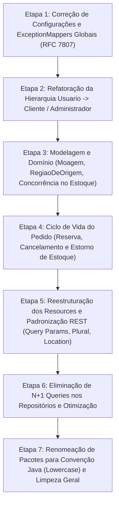

# 08 - Plano Detalhado de Refatoração

**Data do Planejamento:** 21/10/2026  
**Arquiteto/Orquestrador:** Antigravity (Engenheiro de Software Sênior)  
**Status do Portão:** Parte B Iniciada — Baseado nas Decisões Aprovadas pelo Usuário  

---

## 1. Diretrizes Estruturais da Refatoração

1. **Incrementalidade e Continuidade:** A API deve manter-se funcional e compilando a cada etapa (`.\mvnw.cmd compile`).
2. **Preservação de Dados e Scripts:** Atualizar o `import.sql` para refletir as novas colunas e herança sem perder a compatibilidade com a massa de dados inicial.
3. **Padrão REST Canônico:** Recursos no plural, hierarquia lógica, ausência de verbos nos paths, Bean Validation na borda, filtros por query params e Problem Details RFC 7807 global.
4. **Segurança por Padrão (Secure by Default):** Chaves JWT, hashing seguro (BCrypt / PBKDF2 reforçado), autorização por papel (`@RolesAllowed`) e bloqueio de escalada de privilégios.
5. **Rastreabilidade:** Todas as alterações respondem diretamente aos achados documentados no diagnóstico (`07-relatorio-de-diagnostico.md`).

---

## 2. Mapa das Etapas Ordenadas de Refatoração

---

## 3. Detalhamento das Etapas

### Etapa 1: Infraestrutura, Tratamento de Erros e Configuração
- **O que muda:**
  - Atualizar `application.properties`: substituir propriedades deprecated (`quarkus.hibernate-orm.schema-generation.database.action=drop-and-create`, `quarkus.http.cors.enabled=true`, `quarkus.log.console.enable=true`).
  - Corrigir o `AuthResource.login`: retornar `401 Unauthorized` com Problem Details quando o login falhar (resolvendo o bug do status `204`).
  - Retornar o token JWT e dados do usuário no corpo JSON do login (`AuthDTOResponse`), além do header `Authorization`.
  - Implementar `GlobalExceptionMapper` abrangente para `WebApplicationException` (`404`, `400`, `403`), `OptimisticLockException` (`409`) e `PSQLException` / integridade referencial (`409 Conflict`), garantindo que **nenhum erro retorne corpo vazio ou 500 sem tratamento**.
- **Achados Justificadores:** `[CRÍTICA] Login 204`, `[MÉDIA] ExceptionMappers Incompletos`.
- **Risco:** Baixo.
- **Forma de Reversão:** Restaurar versão anterior dos mappers e properties.
- **Critério de Aceite:** Requisições para IDs inexistentes retornam `404` com JSON Problem Details; login com senha errada retorna `401`.

---

### Etapa 2: Hierarquia de Usuários (`Usuario` → `Cliente` / `Administrador`)
- **O que muda:**
  - Tornar `Usuario` abstrata contendo os campos comuns: `id`, `nome`, `email` (UNIQUE, NOT NULL), `cpf` (UNIQUE, NOT NULL), `senha`, `dataNascimento`, `perfil` (enum estrito).
  - Criar subclasse `Cliente extends Usuario` (`@PrimaryKeyJoinColumn(name = "id")`) contendo `enderecos` e `telefones`.
  - Criar subclasse `Administrador extends Usuario` (`@PrimaryKeyJoinColumn(name = "id")`) contendo dados administrativos (ex.: `cargo`).
  - Criar repositórios e serviços especializados: `ClienteService` e `AdministradorService`.
  - Extinguir a criação/edição genérica e desprotegida em `/usuarios`.
  - Criar `POST /clientes` (público para autocadastro, perfil `USER` forçado).
  - Criar `AdministradorResource` (`/administradores`), acessível estritamente por `@RolesAllowed({"Administrador"})`.
  - Criar `/usuarios/me` (perfil do usuário autenticado para consulta própria e alteração de senha).
  - Atualizar `import.sql` com o campo `email` e tabela `administrador`.
- **Achados Justificadores:** `[CRÍTICA] Ausência total de segurança em /usuarios`, `[CRÍTICA] Escalada de privilégio`, `[ALTA] Falta de @Valid`.
- **Risco:** Médio (alteração do modelo relacional de usuários).
- **Forma de Reversão:** Reverter migração e entidades via Git.
- **Critério de Aceite:** Usuário comum não consegue cadastrar admin; cliente autenticado acessa `/usuarios/me` sem ver dados de terceiros; login funciona via e-mail e senha.

---

### Etapa 3: Domínio de Café (Moagem, Região de Origem e Concorrência no Estoque)
- **O que muda:**
  - Criar enum `Moagem` (`EM_GRAOS`, `MOIDO_FILTRO`, `MOIDO_ESPRESSO`, `MOIDO_PRENSA_FRANCESA`).
  - Adicionar suporte a moagem em `Cafe` (moagens aceitas) e em `ItemPedido` (moagem escolhida pelo cliente).
  - Ajustar `Cafe.peso`: de `Double` para `BigDecimal` ou `Integer` em gramas com validação estrita.
  - Adicionar `@Version private Long versao;` na entidade `Estoque` para controle de concorrência otimista (evitar Lost Update).
  - Adicionar campo `ativo` (booleano) em `Cafe` para suporte a **soft delete** (impedindo erro 500 em cafés com pedidos vinculados).
  - Completar a entidade `RegiaoDeOrigem`: criar `RegiaoDeOrigemRepository`, `RegiaoDeOrigemService`, `RegiaoDeOrigemResource` (`/regioes-origem`), DTOs e vinculação ao `Cafe`.
- **Achados Justificadores:** `[ALTA] Ausência de trava de concorrência no Estoque`, `[MÉDIA] Exclusão física gera erro 500`, `[BAIXA] Entidade órfã RegiaoDeOrigem`.
- **Risco:** Baixo a Médio.
- **Forma de Reversão:** Reverter commits da modelagem de café e estoque.
- **Critério de Aceite:** Exclusão de café que possui pedidos desativa o produto sem quebrar integridade; duas compras concorrentes no mesmo café não causam saldo negativo.

---

### Etapa 4: Ciclo de Vida do Pedido (Reserva, Cancelamento e Estorno)
- **O que muda:**
  - Vincular `Pedido` a `Cliente` (em vez de `Usuario` genérico).
  - Endereço de entrega no pedido com proteção de imutabilidade histórica (snapshot de endereço ou vínculo seguro).
  - Implementar endpoint `POST /pedidos/{id}/cancelamento`:
    - Verifica se o pedido pertence ao usuário logado ou a um admin.
    - Valida status (apenas pedidos em `AGUARDANDO_PAGAMENTO` ou `PAGO` antes de envio podem ser cancelados).
    - Altera status para `CANCELADO`.
    - **Estorna transacionalmente** as quantidades dos itens de volta para a entidade `Estoque`.
  - Reestruturar `POST /pedidos/{id}/pagamento` ou manter pagamento subordinado.
- **Achados Justificadores:** `[ALTA] Baixa imediata de estoque sem rotina de cancelamento/estorno`.
- **Risco:** Médio.
- **Forma de Reversão:** Reverter serviço de pedidos.
- **Critério de Aceite:** Ao criar pedido, estoque é decrementado; ao cancelar o pedido, o estoque volta exatamente ao saldo original.

---

### Etapa 5: Reestruturação dos Resources e Padronização REST
- **O que muda:**
  - Renomear `@Path("/endereco")` para `@Path("/enderecos")`.
  - Eliminar caminhos com verbos:
    - `GET /cafes/search/nome/{nome}` e `GET /cafes/search/pontuacao` → `GET /cafes?nome=...&minPontuacao=...&maxPontuacao=...`
    - `GET /categorias/search/{nome}` → `GET /categorias?nome=...`
    - `GET /marcas/search/{nome}` → `GET /marcas?nome=...`
    - `GET /estados/find/{nome}` → `GET /estados?nome=...`
    - `GET /municipios/find/{nome}` → `GET /municipios?nome=...`
    - `GET /pedidos/usuario/{id}` → `GET /pedidos?idUsuario=...` ou `GET /clientes/me/pedidos`
  - Incluir header `Location` em todos os retornos `HTTP 201 Created` (`URI.create(uriInfo.getAbsolutePath() + "/" + id)`).
  - Reativar e consolidar `@RolesAllowed` em todos os controllers (catálogo público para leitura, restrito a `Administrador` para escrita).
  - Adicionar `@Valid` em todos os parâmetros de entrada dos controllers.
- **Achados Justificadores:** `[MÉDIA] Caos nas rotas de busca`, `[MÉDIA] Recurso no singular`, `[ALTA] Escrita pública no catálogo`.
- **Risco:** Baixo (alteração de camada web e documentação de impacto para o frontend).
- **Forma de Reversão:** Reverter arquivos de resource.
- **Critério de Aceite:** Todos os endpoints seguem a especificação RESTful; OpenAPI reflete 100% o comportamento real.

---

### Etapa 6: Otimização de Consultas e Eliminação de N+1
- **O que muda:**
  - Criar consulta com projeção DTO ou `JOIN FETCH` em `CafeRepository` para carregar dados do café + saldo de estoque + marca + categoria em 1 única query.
  - Eliminar o loop serial de busca de estoque em `CafeServiceImpl.findAll`.
- **Achados Justificadores:** `[ALTA] Vulnerabilidade N+1 Queries na listagem de cafés`.
- **Risco:** Baixo.
- **Critério de Aceite:** Log SQL do Hibernate exibe 1 única query para `GET /cafes`, independentemente do número de registros.

---

### Etapa 7: Limpeza de Débitos Técnicos e Convenção Java
- **O que muda:**
  - Refatorar nomes de pacotes de PascalCase para lowercase: `auth`, `cafe`, `cliente`, `administrador`, `pedido`, etc.
  - Dropar as tabelas residuais no PostgreSQL (`fornecedor`, `produto`, `sabor`, `produto_sabor`, `categoria`).
  - Remover todo código comentado e imports mortos.
  - Gerar documentação final de impacto para o frontend Angular em `impacto-frontend-angular.md`.
- **Achados Justificadores:** `[BAIXA] Convenção de nomes PascalCase`, `[BAIXA] Tabelas residuais`.
- **Risco:** Baixo.
- **Critério de Aceite:** Código 100% limpo, compilação sem warnings e testes verdes.
