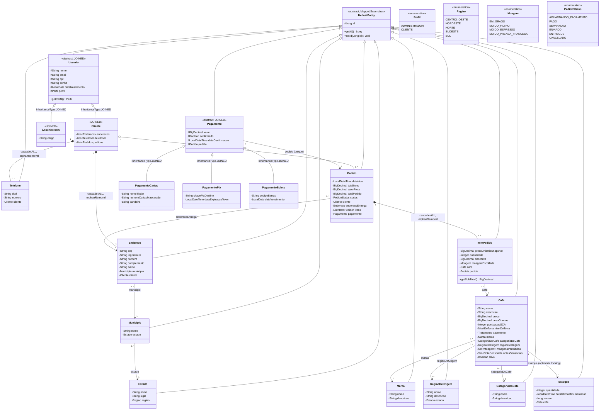
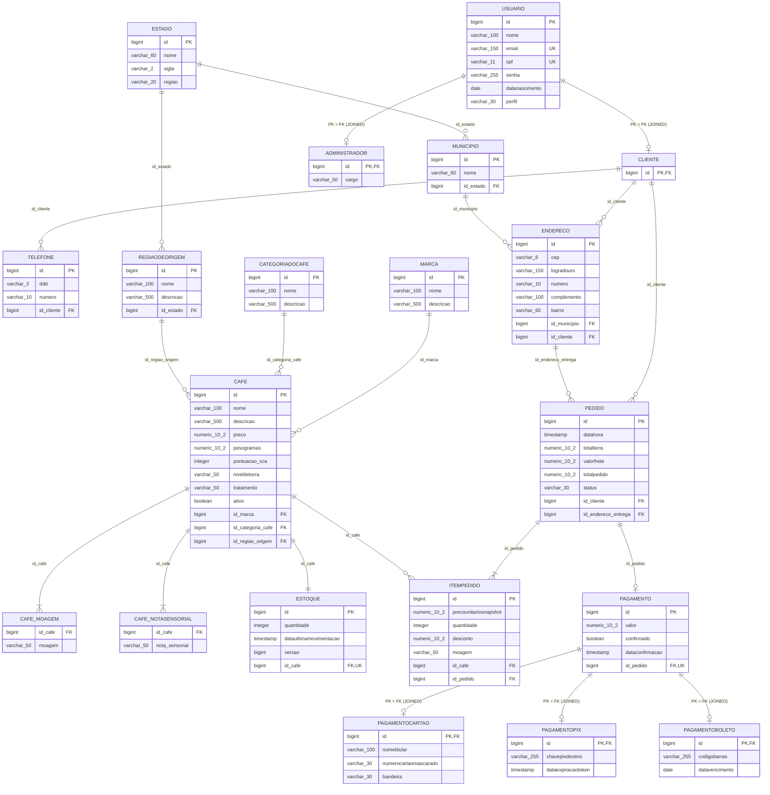

# 10 - Modelagem UML Final (Estado Alvo Pós-Refatoração)

**Data:** 21/10/2026  
**Arquiteto:** Antigravity  
**Fase:** Modelagem da Arquitetura Alvo (Comparativo com `02-dominio-e-uml-atual.md`)  

---

## 1. Diagrama de Classes UML Alvo (Arquitetura Refatorada)

---

## 2. Diagrama Entidade-Relacionamento Final (PostgreSQL)

---

## 3. Principais Ganhos e Diferenças em Relação ao Estado Inicial

| Item | Estado Inicial (`02-dominio-e-uml-atual.md`) | Estado Final (`10-uml-final.md`) | Ganho Arquitetural |
|---|---|---|---|
| **Hierarquia de Usuários** | `Usuario` concreto com tabela associativa `usuario_perfil`. `Cliente` vazio. Sem classe `Administrador`. | `Usuario` abstrato com herança `JOINED` para `Cliente` e `Administrador`. | **Fim da escalada de privilégios.** Responsabilidades e atributos explícitos por tipo de ator. |
| **Identificação** | `login` textual puro e sem campo `email`. | `email` único e obrigatório com validação `@Email`. | Alinhamento total com padrões de e-commerce e recuperação de conta. |
| **Segurança em Pedidos** | Pedido vinculado a `Usuario` genérico. | Pedido vinculado a `Cliente`. | Coerência de domínio: apenas clientes compram e possuem histórico de pedidos. |
| **Concorrência em Estoque** | Entidade `Estoque` sem controle de versão. Risco de Lost Update. | `@Version private Long versao;` | Prevenção absoluta contra estoque negativo em concorrência. |
| **Ciclo de Vida do Pedido** | Baixa imediata de estoque sem possibilidade de cancelamento/estorno. | Endpoint `POST /pedidos/{id}/cancelamento` com estorno transacional do estoque. | Gestão correta de pedidos desistidos ou boletos/pix expirados. |
| **Atributo Moagem** | Inexistente. | Enum `Moagem` no catálogo e seleção no `ItemPedido`. | Especialização para o domínio real de grãos de café. |
| **Região de Origem** | Entidade órfã sem CRUD nem DTOs. | Entidade completa integrada a Estado e Café. | Valorização do terroir de cafés especiais (Sul de Minas, Cerrado Mineiro, etc.). |
| **Tratamento de Exclusão de Café** | Exclusão física que estourava erro 500 se o café já tivesse sido comprado. | Soft delete com campo `ativo` (booleano). | Integridade histórica garantida sem quebra de banco. |
