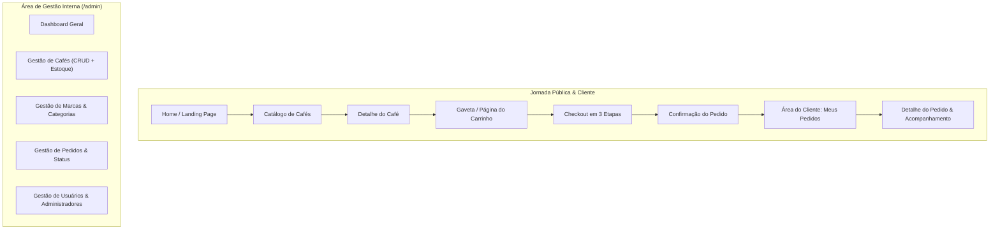

# Dorana Coffee Shop — Proposta Completa de UI/UX Design & Design System

**Projeto:** E-commerce de Grãos de Café Especial e Gourmet  
**Marca Oficial:** **Dorana** COFFEE SHOP  
**Referência Visual:** Google Stitch (`projects/380010699380536499` — *Torrefação Nobre*)  
**Alinhamento Técnico:** Arquitetura Angular 21 (Standalone + Angular Material M3) & Backend Quarkus 3.26+  

---

## 1. Fundamentos da Identidade & Design System

A identidade visual da **Dorana Coffee Shop** combina o universo acolhedor e artesanal das microtorrefações de café de especialidade com a precisão minimalista de um comércio eletrônico editorial premium contemporâneo.

```
       D O R A N A
       C O F F E E   S H O P
```
- **"Dorana"**: Tipografia serifada nobre *Playfair Display*, peso 700, cor `#130804` (ou `#FFFDF9` em superfícies escuras).
- **"COFFEE SHOP"**: Tipografia *Plus Jakarta Sans*, peso 600, caixa alta, tracking expandido (`letterSpacing: 0.22em`), cor `#885031` (Caramelo Queimado) ou `#C87A3E` (Cobre Imperial).

### 1.1 Paleta de Cores Rigorosa (Tokens Hexadecimais)

| Token Semântico | Código HEX | Nome Cultural | Aplicação na Interface |
|---|:---:|---|---|
| `primary` | `#130804` | Café Ébano | Header de autoridade, textos de títulos nobres, botões primários |
| `primary-container` | `#2C1E18` | Tostado Profundo | Cards elevados de destaque, hero banners, footer institucional |
| `secondary` | `#885031` | Caramelo Queimado | Subtítulos, preços em destaque, badges de processo, acentos |
| `secondary-container` | `#FFB68F` | Âmbar Suave | Indicadores secundários de hover, fundos de chips selecionados |
| `tertiary / accent` | `#C87A3E` | Cobre Imperial | Badges de pontuação SCA (85+), CTAs principais, indicadores ativos |
| `background` | `#FFF8F6` | Creme Alabastro | Fundo geral da página (elimina luz azul dura, leitura confortável) |
| `surface` | `#FFFDF9` | Seda Quente | Fundo de cards de produto, diálogos, tabelas e caixas de formulário |
| `surface-container` | `#FFE9E2` | Pêssego Aveludado | Áreas de filtros laterais, headers de tabelas, drawers do carrinho |
| `outline` | `#817570` | Canela Seca / Taupe | Bordas de inputs, divisores discretos, bordas de cards |
| `error` | `#BA1A1A` | Cereja de Café Madura| Alertas de validação, erro no checkout, badge de cancelamento |

### 1.2 Tipografia & Hierarquia

- **Títulos e Marca:** `Playfair Display` (Serif). Evoca tradição, requinte e gastronomia de alta qualidade.
  - *Display:* 56px / 64px, SemiBold (`#130804`)
  - *Headline Large:* 40px / 48px, SemiBold
  - *Headline Medium:* 28px / 36px, SemiBold
  - *Headline Small:* 22px / 30px, Medium
- **Corpo, Interfaces, Tabelas e Dados:** `Plus Jakarta Sans` (Sans-Serif). Legibilidade técnica impecável, formas humanistas.
  - *Body Large:* 18px / 28px, Regular
  - *Body Medium:* 16px / 24px, Regular
  - *Body Small:* 14px / 20px, Regular (metadados de altitude, produtor, SCA)
  - *Label Large / Medium:* 15px / 13px, SemiBold (botões, tabs e títulos de colunas)
  - *Label Small:* 11px / 16px, Bold, Tracking `0.05em` (chips de notas sensoriais)

### 1.3 Formas, Elevações & Sombras

- **Raio de Borda (Rounded):**
  - Inputs, botões e campos de formulário: `8px` (`rounded-md`).
  - Cards de produto e painéis: `16px` (`rounded-lg`).
  - Badges de notas sensoriais e selos SCA: `9999px` (`rounded-full` em formato pílula).
- **Sombras Naturais (Warm Depth):**
  - Nível 1 (Card normal): `0 2px 10px -2px rgba(44, 30, 24, 0.05), 0 1px 3px rgba(44, 30, 24, 0.04)`.
  - Nível 2 (Hover e Menus): `0 8px 24px -4px rgba(44, 30, 24, 0.10)`.
  - Nível 3 (Gaveta do Carrinho e Modais): `0 20px 48px -10px rgba(19, 8, 4, 0.25)`.

---

## 2. Mapeamento Arquitetural: UML ↔ Telas

Todas as telas e fluxos foram projetados em aderência estrita às entidades, campos e enums do modelo do backend:



### Entidades do UML Representadas na UI:
- **`Cafe`**: `nome`, `descricao`, `preco`, `peso` (gramas), `pontuacaoSCA`, `nivelDeTorra` (`CLARA`, `MEDIA`, `ESCURA`), `tratamento` (`NATURAL`, `LAVADO`, `CD`, `HONEY`), `ativo`, `marca`, `categoriaDoCafe`, `regiaoDeOrigem` (`nome`, `estado`), `notasSensoriais` (`FRUTADO`, `FLORAL`, `CHOCOLATE`, `CARAMELO`, `CITRICO`, `ESPECIARIAS`).
- **`Estoque`**: `quantidade` e controle de concorrência com `@Version`.
- **`ItemPedido`**: `quantidade`, `precoUnitario` (snapshot histórico), `cafe`.
- **`Pedido`**: `dataCriacao`, `total`, `status` (`AGUARDANDO_PAGAMENTO`, `PAGO`, `ENVIADO`, `ENTREGUE`, `CANCELADO`), `cliente`, `itens`, `pagamento`.
- **`Pagamento`**: `PagamentoCartao` (titular, número, bandeira, validade, cvv), `PagamentoBoleto` (código de barras, vencimento), `PagamentoPix` (QR Code dinâmico e código Copia e Cola).
- **`Cliente` & `Usuario`**: `nome`, `email`, `cpf`, `login`, `telefones` (`ddd`, `numero`), `enderecos` (`rua`, `numero`, `complemento`, `bairro`, `cep`, `municipio`, `estado`).

---

## 3. Especificação das Telas da Jornada do Consumidor

### 3.1 Cabeçalho Global (Topbar & Navbar)

- **Faixa Superior de Utilidade (`#2C1E18`):** Informações de frete para cafés especiais e horário de torra semanal.
- **Header Principal (`#FFFDF9`, borda inferior `#E2D6CA` de 1px):**
  - **Lado Esquerdo:** Menu hambúrguer (mobile) / Links: *Cafés Especiais*, *Categorias*, *Marcas*, *Nossa Origem*.
  - **Centro:** Logotipo da marca com grande impacto visual:
    ```
          D O R A N A
       C O F F E E   S H O P
    ```
  - **Lado Direito:**
    - Barra de pesquisa expansível com autocomplete por nome do café e notas sensoriais (`mat-form-field` estilizado).
    - Botão de Conta do Usuário (`mat-icon`: `person_outline`): Se deslogado, abre modal/rota `/login`; se logado, exibe menu drop-down (*Meus Pedidos*, *Meus Endereços*, *Sair*).
    - Botão do Carrinho (`mat-icon`: `shopping_bag`): Badge circular em Cobre Imperial (`#C87A3E`) exibindo a contagem viva de itens. Ao clicar, abre o drawer lateral do carrinho.

---

### 3.2 Página Inicial (Home / Landing Page)

1. **Hero Section (Impacto Sensorial Editorial):**
   - Fotografia panorâmica em alta definição: extração de espresso aveludado com crema tigrada e grãos tostados em superfície de nogueira escura.
   - Tipografia: *Headline Display* em Playfair Display: *"O Ritual Sagrado do Café de Especialidade"*.
   - Subtítulo: *"Microlotes selecionados acima de 84 pontos SCA, torrados artesanalmente em pequenos lotes para preservar o terroir e a alma de cada grão."*
   - Botão Primário: `Explorar Cafés da Safra` (`#130804` com texto `#FFFDF9`, ícone de seta).
   - Botão Secundário: `Conheça Nossas Fazendas` (estilo outline em `#885031`).

2. **Destaques da Safra (Carrossel / Grid de Microlotes):**
   - Cards com selo dourado/cobre de Pontuação SCA (ex.: `88 Pontos SCA`), foto de embalagem fosca com válvula aromática, nome da fazenda, nível de torra e chips coloridos de notas sensoriais (ex.: `Cítrico`, `Caramelo`).
   - Preço, peso em gramas e botão direto `Adicionar à Xícara`.

3. **Navegação Sensorial por Perfil e Categorias:**
   - 4 blocos ilustrados com as categorias do café cadastradas no sistema: *Especiais*, *Gourmet*, *Microlotes Raros*, *Origens Únicas*.
   - Seletor rápido de Torra: Clara, Média e Escura com explicações sensoriais de cada perfil.

4. **Transparência da Origem (Do Grão à Xícara):**
   - Seção interativa com mapa das regiões cafeeiras do Brasil (`RegiaoDeOrigem` vinculada ao `Estado` do modelo).
   - Informações de altitude, variedade botânica e processos de secagem (`Natural`, `Lavado`, `Honey`, `Cereja Descascado`).

5. **Rodapé Institucional Completo (`#130804` com textos em `#FFF8F6`):**
   - Assinatura nobre da marca **Dorana COFFEE SHOP**.
   - Links institucionais: Rastreabilidade, Políticas de Entrega, Perguntas Frequentes.
   - Formas de Pagamento aceitas: Cartões de Crédito, Boleto Bancário e Pix.
   - Selo de compra 100% segura e copyright oficial.

---

### 3.3 Catálogo e Listagem de Produtos (`/cafes`)

- **Barra Lateral de Filtros Avançados (Desktop) / Modal de Filtros (Mobile):**
  - **Busca por Palavra-Chave:** Filtra por nome do café ou marca.
  - **Filtro por Pontuação SCA:** Slider duplo de 80 a 100 pontos.
  - **Filtro por Processo de Tratamento (Checkboxes):** `Natural`, `Lavado`, `CD (Cereja Descascado)`, `Honey`.
  - **Filtro por Nível de Torra (Radio/Chips):** `Torra Clara`, `Torra Média`, `Torra Escura`.
  - **Filtro por Notas Sensoriais (Multi-chips táteis):** `Frutado`, `Floral`, `Chocolate`, `Caramelo`, `Cítrico`, `Especiarias`.
  - **Filtro por Marca e Categoria.**
- **Barra de Controle Superior:**
  - Contador dinâmico: *"Exibindo 12 cafés artesanais"*.
  - Drop-down de ordenação: *Maior Pontuação SCA*, *Menor Preço*, *Maior Preço*, *Nome (A-Z)*.
- **Card de Produto (Fidelidade Visual Stitch):**
  - Proporção 4:5 com embalagem sofisticada e textura táctil.
  - Tag superior esquerda: Badge flutuante `#130804` com texto em Cobre `#C87A3E` (`86.5 SCA`).
  - Marca e Região de Origem em `body-sm` (`#885031`).
  - Nome do Café em `headline-sm` Playfair Display.
  - Tags de Notas Sensoriais em pílula pastel com borda suave de 1px.
  - Preço em destaque em `headline-md` e indicação do peso (ex.: `250g`).
  - Badge de Disponibilidade: `Em Estoque` (verde oliva suave) ou `Esgotado` (cinza taupe).
  - Ação: Botão `Ver Detalhes` e ícone rápido `+ Carrinho` (desabilitado se `estoque.quantidade == 0`).

---

### 3.4 Detalhamento do Café (`/cafes/:id`)

- **Galeria de Imagens (50% da largura no Desktop):**
  - Foto principal de alta resolução da embalagem e grãos torrados inteiros.
  - Miniaturas complementares: close macro do grão torrado, foto da fazenda de origem e ritual de preparo.
- **Painel de Compra e Especificações (50% da largura):**
  - Marca e Categoria em texto capitel refinado.
  - Nome do Produto em `headline-lg` (`Playfair Display`).
  - Card de Pontuação SCA: caixa elevada com o número oficial SCA e selo de certificação sensorial.
  - Preço em destaque: `R$ 48,00` (com indicação do peso `250g` fixado conforme modelo `Cafe.peso`).
  - **Ficha Técnica Sensorial (Grid 2x2 elegante):**
    - **Nível de Torra:** Indicador visual de intensidade (ex.: Torra Média).
    - **Processo / Tratamento:** `Natural` ou `Lavado`.
    - **Região de Origem:** Ex.: Cerrado Mineiro, MG.
    - **Notas Sensoriais:** Badges elegantes com ícones florais/frutados/cacau.
  - **Controle de Quantidade:** Botões seletores `[-] 1 [+]` limitados pelo saldo disponível em `Estoque.quantidade`.
  - **Botão Principal de Compra:** `<button mat-raised-button>` em largura total na cor `#130804` com texto `#FFFDF9`: *"Adicionar ao Carrinho • R$ 48,00"*.
  - **Acordeão de Abas (`mat-accordion`):**
    - *Sobre o Produtor & Terroir:* História da região e método de cultivo.
    - *Dicas de Extração:* Sugestão de proporção (ex.: 1:15 no filtro V60) e temperatura da água.
    - *Envio & Frescor da Torra:* Política de envio com torra recente garantida.

---

### 3.5 Gaveta e Página do Carrinho de Compras (`/carrinho`)

- **Estrutura Híbrida:** Acesso instantâneo via **Drawer Lateral Flutuante** (ao clicar na sacola) ou **Página Completa de Revisão** (`/carrinho`).
- **Lista de Itens do Pedido (`ItemPedido`):**
  - Imagem miniatura da embalagem, nome do café e marca.
  - Preço unitário e subtotal calculado em tempo real (`quantidade * precoUnitario`).
  - Seletor de quantidade `[-] n [+]` com debounce de atualização.
  - Botão de remoção rápida (ícone `delete_outline` com confirmação discreta).
  - Alerta dinâmico caso a quantidade escolhida exceda o estoque disponível no banco.
- **Painel de Resumo de Valores (`#FFE9E2` com cantos arredondados de 16px):**
  - Subtotal dos Cafés.
  - Estimativa de Frete por CEP (consumindo o endereço cadastrado do cliente).
  - **Valor Total do Pedido em Destaque (`#130804`).**
  - Botão de Ação: `Prosseguir para o Checkout` (botão largo em `#130804` com ícone de cadeado de segurança).
- **Estado Vazio (Empty State):**
  - Ilustração minimalista de um filtro de café vazio com traços em canela seca.
  - Frase acolhedora: *"Sua xícara ainda está vazia. Que tal conhecer os microlotes frescos da nossa última torra?"*
  - Botão `Explorar Cafés`.

---

### 3.6 Fluxo de Checkout em Etapas Claras (`/checkout`)

O checkout foi projetado no padrão "Stepped Accordion" (sem recarregamentos de página), garantindo foco máximo e taxa de conversão elevada:

1. **Etapa 1: Identificação do Cliente:**
   - Se autenticado: Reconhece nome, email e CPF automaticamente.
   - Se visitante: Formulário conciso de autenticação rápida ou autocadastro de cliente (`POST /clientes`).

2. **Etapa 2: Endereço de Entrega (`Endereco` do UML):**
   - Seleção por rádio de endereços já cadastrados na conta do cliente (Rua, Número, Bairro, Município, Estado, CEP).
   - Botão para cadastrar novo endereço via formulário em modal ou colapsável.

3. **Etapa 3: Seleção e Processamento do Pagamento (`Pagamento` do UML):**
   - **Opção A: Cartão de Crédito (`PagamentoCartao`):**
     - Campos: Nome do Titular impresso no cartão, Número do Cartão (com detecção visual automática de bandeira: Visa, Mastercard, Elo), Validade (`MM/AA`) e CVV (3 dígitos).
     - Componente interativo simulando o cartão virtual em tons nobres de café e cobre.
   - **Opção B: Pix Instantâneo (`PagamentoPix`):**
     - Gera QR Code de alta resolução com chave Pix dinâmica e botão com um clique `Copiar Código Pix`.
     - Contador de tempo de expiração do Pix (30 minutos) e badge de espera ativa por webhook.
   - **Opção C: Boleto Bancário (`PagamentoBoleto`):**
     - Exibição de código de barras digitável, data de vencimento e botão `Visualizar Boleto em PDF`.

4. **Revisão Final e Confirmação (`POST /pedidos`):**
   - Resumo condensado de itens, endereço e modalidade de pagamento.
   - Botão de Confirmação: `Finalizar Pedido com Segurança`.
   - Transição com loading overlay elegante em Cobre Imperial.
   - **Tela de Sucesso (`/checkout/sucesso/:id`):** Número do pedido `#PED-XXXX`, status inicial (`AGUARDANDO_PAGAMENTO` ou `PAGO`), estimativa de entrega e botão `Acompanhar Meu Pedido`.

---

### 3.7 Área do Cliente (`/minha-conta`)

Estruturada em layout de abas ou menu lateral intuitivo:

- **Meus Pedidos:**
  - Tabela com histórico de compras: Código, Data, Valor Total, Forma de Pagamento e **Chip de Status Colorido**:
    - `Aguardando Pagamento`: Laranja Toffee suave (`#C87A3E`)
    - `Pago`: Verde Folha de Café (`#2E7D32`)
    - `Enviado`: Azul Petróleo Suave (`#0277BD`)
    - `Entregue`: Verde Oliva Escuro (`#1B5E20`)
    - `Cancelado`: Vermelho Cereja (`#BA1A1A`)
  - Ação `Ver Detalhes do Pedido`: abre linha do tempo com itens comprados, fotos e botão `Cancelar Pedido` (permitido apenas para pedidos em espera antes do despacho, com estorno automático no estoque).
- **Meus Dados Cadastrais:**
  - Edição de nome, telefone e data de nascimento.
  - Tela de alteração de senha segura (`PUT /usuarios/me/senha`).
- **Meus Endereços de Entrega:**
  - Lista de cards com endereços cadastrados, opção de marcar como padrão, editar ou excluir.

---

## 4. Especificação da Interface Administrativa (`/admin`)

Projetada com base nos componentes robustos do Angular Material (`MatTable`, `MatPaginator`, `MatSort`, `MatDialog`), com tema harmonizado às cores da **Dorana Coffee Shop**:

### 4.1 Dashboard Executivo (`/admin/dashboard`)
- **Cards de Indicadores Principais (KPIs):**
  - Total de Pedidos Realizados e Faturamento do Mês.
  - Cafés Ativos no Catálogo.
  - Alerta Crítico de Estoque Baixo (produtos com menos de 5 unidades em `Estoque.quantidade`).
- **Tabela de Pedidos Recentes:** Acesso rápido aos últimos pedidos para atualização de status operacional.

### 4.2 Gestão de Cafés (`/admin/cafes`)
- **Tabela Administrativa:** Colunas: *ID*, *Foto*, *Nome*, *Marca*, *Categoria*, *Preço*, *Peso*, *Pontuação SCA*, *Estoque*, *Status (Ativo/Inativo)*, *Ações*.
- **Formulário Completo (`/admin/cafes/new` e `/admin/cafes/edit/:id`):**
  - Dados Básicos: Nome, Descrição comercial.
  - Atributos Comerciais: Preço (R$), Peso (gramas), Quantidade Inicial de Estoque.
  - Seletores Drop-down (`mat-select`): Marca, Categoria, Região de Origem.
  - Parâmetros Sensoriais: Pontuação SCA (numérico), Nível de Torra (Clara, Média, Escura), Método de Tratamento (Natural, Lavado, CD, Honey).
  - Multi-select de Notas Sensoriais (`mat-chip-grid`).
  - Toggle `Ativo no Catálogo`.

### 4.3 Gestão de Marcas e Categorias (`/admin/marcas` e `/admin/categorias`)
- CRUD completo com busca em tempo real via query param (`?nome=...`), paginação elegante e formulário reativo com validação de duplicidade e obrigatoriedade.

### 4.4 Gestão de Pedidos & Controle de Estoque (`/admin/pedidos`)
- Listagem detalhada de todos os pedidos da loja com filtro por status (`Aguardando Pagamento`, `Pago`, `Enviado`, `Entregue`, `Cancelado`).
- Botão de transição de estado do pedido conforme a evolução da entrega no backend.
- Visão central de Estoque com auditoria de versão (`@Version`) contra race-conditions.

### 4.5 Gestão de Usuários e Administradores (`/admin/usuarios`)
- Listagem com visualização de perfis (`Administrador` vs. `Cliente`).
- Formulário com campos de Nome, Email, Login, Senha, CPF, Data de Nascimento e atribuição de perfis de sistema.

---

## 5. Diretrizes para Direcionamento Fotográfico

Para manter a harmonia com o Google Stitch e afastar qualquer aspecto de "banco de imagens genérico", a direção fotográfica da **Dorana Coffee Shop** adota:

1. **Embalagens:** Fotografia realista em estúdio com luz difusa quente (3200K - 4000K), pacotes de papel kraft premium ou acabamento preto/marrom fosco com válvula desgaseificadora e rótulos tipográficos refinados.
2. **Grãos e Torra:** Textura hiper-nítida dos grãos tostados com reflexos sutis dos óleos essenciais naturais emanados após a curva de torra média.
3. **Ritual de Preparo:** Imagens reais de extração em métodos elegantes (chaleiras bico de ganso de cobre polido, filtros de vidro Chemex, coadores cerâmicos V60 e xícaras de cerâmica rústica vidrada).
4. **Terroir e Origem:** Paisagens autênticas das lavouras das montanhas de Minas Gerais, Alta Mogiana e Cerrado em luz de entardecer dourado.

---

## 6. Conclusão e Prontidão para Implementação

Esta proposta visual unifica de forma cirúrgica:
- O **Design System nobre e aconchegante do Google Stitch** (*Torrefação Nobre*).
- O **nome oficial consolidado**: **Dorana COFFEE SHOP**.
- A **totalidade das entidades, regras e enums do modelo UML/JPA do backend Quarkus**.
- A **arquitetura de componentes Standalone do Angular 21 com Angular Material M3**.

O projeto encontra-se perfeitamente delimitado para evolução visual contínua e implementação direta no código-fonte do front-end.
